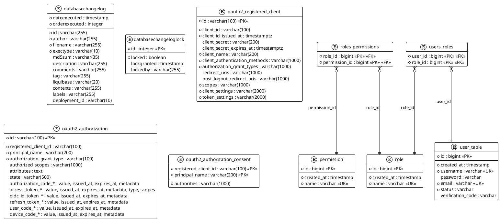

# ER Diagram: ER Diagram

## Tables

| # | Table | Columns |
|---|-------|---------|
| 1 | **databasechangelog** | id, author, filename, dateexecuted, orderexecuted, exectype, md5sum, description, comments, tag, liquibase, contexts, labels, deployment_id |
| 2 | **databasechangeloglock** | id, locked, lockgranted, lockedby |
| 3 | **oauth2_authorization** | id, registered_client_id, principal_name, authorization_grant_type, authorized_scopes, attributes, state, authorization_code_* (value, issued_at, expires_at, metadata), access_token_* (value, issued_at, expires_at, metadata, type, scopes), oidc_id_token_* (value, issued_at, expires_at, metadata), refresh_token_* (value, issued_at, expires_at, metadata), user_code_* (value, issued_at, expires_at, metadata), device_code_* (value, issued_at, expires_at, metadata) |
| 4 | **oauth2_authorization_consent** | registered_client_id, principal_name, authorities |
| 5 | **oauth2_registered_client** | id, client_id, client_id_issued_at, client_secret, client_secret_expires_at, client_name, client_authentication_methods, authorization_grant_types, redirect_uris, post_logout_redirect_uris, scopes, client_settings, token_settings |
| 6 | **permission** | id, created_at, name |
| 7 | **role** | id, created_at, name |
| 8 | **roles_permissions** | role_id, permission_id |
| 9 | **user_table** | id, created_at, username, password, email, status, verification_code |
| 10 | **users_roles** | user_id, role_id |

The `oauth2_*` tables (Spring Authorization Server schema, `2_create-oauth2-authorization-server-tables.yml`) have
no foreign keys; `registered_client_id` refers to `oauth2_registered_client.id` by convention.

## Entity Relationship Diagram

